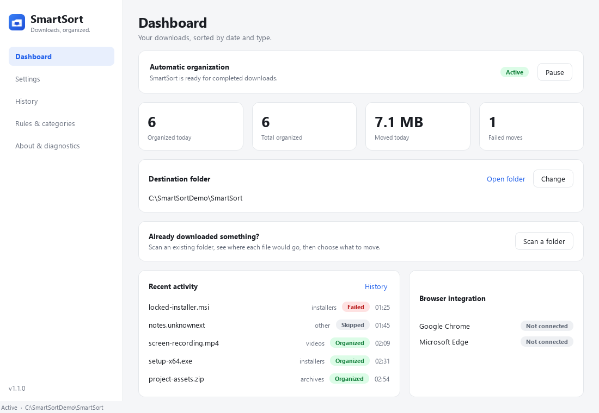
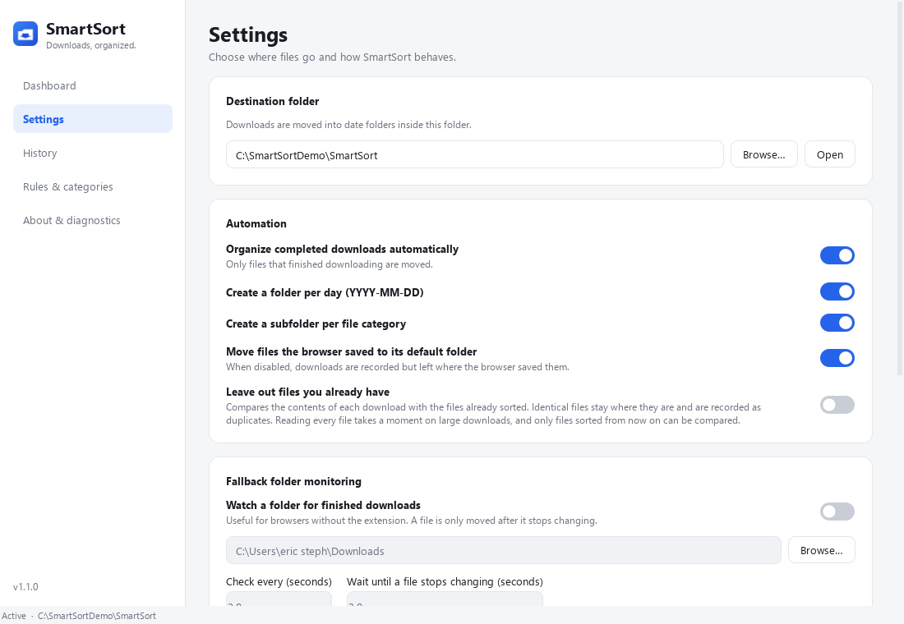
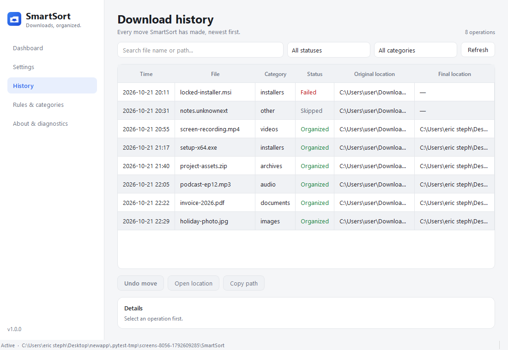
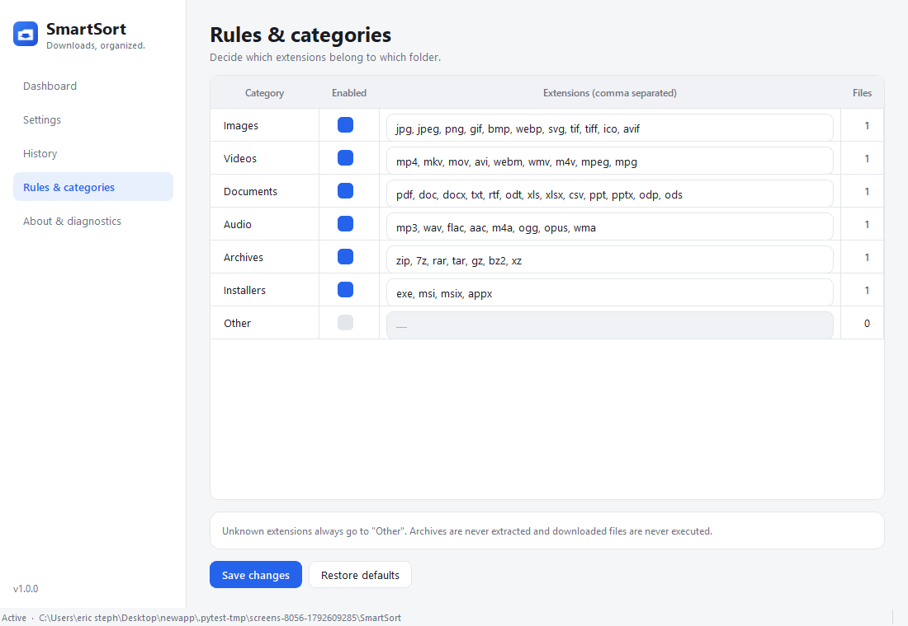
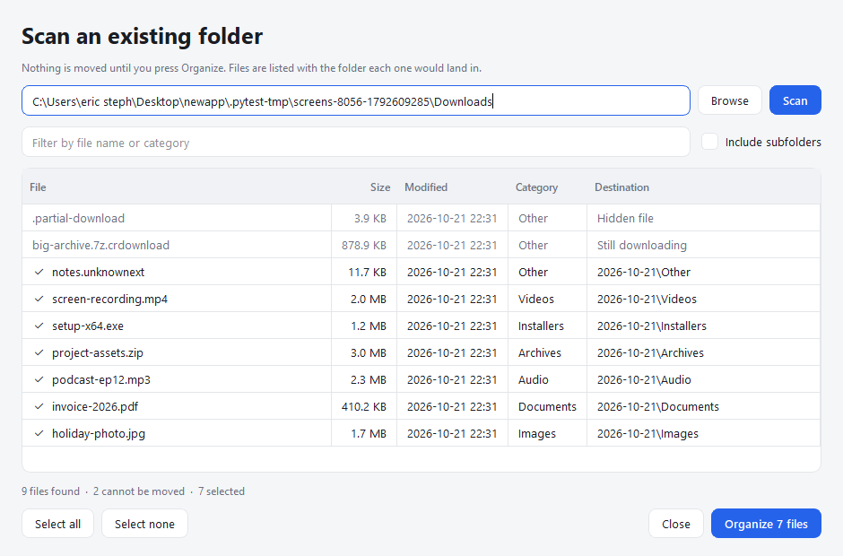
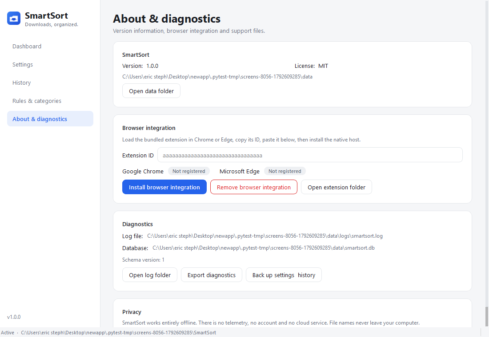

# SmartSort

**Downloads, organized.** A local-first Windows desktop application that moves
completed browser downloads into date and file-type folders.

[](#requirements)
[](#option-c--run-from-source)
[](LICENSE)
[](#privacy)



```
E:\SmartSort\
    2026-10-21\
        Images\      Documents\   Audio\
        Videos\      Archives\    Installers\   Other\
    2026-10-22\
        ...
```

SmartSort is deterministic and offline. There is no AI, no account, no cloud
service, no telemetry and no paid API. It is a rules engine plus a careful file
mover.

---

## What it does

| | |
|---|---|
| **Sorts completed downloads** | Date folder (`YYYY-MM-DD`, from the download completion time) → category folder → file. |
| **Never overwrites** | Conflicts become `photo (1).jpg`, `photo (2).jpg`, … resolved atomically at the OS level. |
| **Never touches in-progress files** | `.crdownload`, `.part`, `.partial`, `.tmp`, … are skipped, and the file must also be closed by the browser. |
| **Never loses the source** | Cross-volume moves copy → verify → atomically rename → only then delete the source. |
| **Records everything** | Every move is written to SQLite with both paths, size, category, timestamps and status. |
| **Can undo** | One click restores a file to where it came from, without overwriting anything. |
| **Can leave out what you already have** | Optional: hashes each download and skips the ones whose content is already sorted, recording them as duplicates instead of filing a second copy. Off by default. |
| **You can add your own categories** | Name a category and give it extensions; it becomes its own folder. Built-in categories keep their names, so files already sorted are never split across two folders. |
| **Works with Chrome and Edge** | A Manifest V3 extension reports finished downloads through a native messaging host. |
| **Works without the extension** | A fallback folder watcher handles any browser or download manager. |
| **Handles what is already there** | Scan an existing folder, see where every file would land, then choose what to move. Nothing moves without confirmation. |

---

## Requirements

- Windows 10 or 11, 64-bit
- Python 3.10+ (only for a source install; the portable build needs nothing)
- Chrome or Edge 102+ (optional, for the browser integration)

---

## Install

Two artifacts are produced, both per-user and both without administrator rights:

```
dist\SmartSort-1.0.0-portable.zip     unzip anywhere, data stays with it
dist\SmartSort-Setup-1.0.0.exe        installer with shortcuts and an uninstaller
```

Published builds are attached to the [releases](https://github.com/eericstephh/SmartSort/releases) page. Every
release carries a `SHA256SUMS.txt`; check a download before running it:

```powershell
Get-FileHash .\SmartSort-1.0.0-portable.zip -Algorithm SHA256
```

Build both from source with:

```powershell
.\scripts\build_windows.ps1          # the application folder
python scripts\build_release.py      # the zip, the installer, and release\
```

`build_release.py` leaves a `release\` folder containing exactly the files to
attach to a GitHub release, plus the checksums and the release notes taken from
[CHANGELOG.md](CHANGELOG.md).

### Option A — portable

Unzip `SmartSort-1.0.0-portable.zip` and run `SmartSort.exe`. The folder contains
`portable.txt`, which keeps the database, logs and bridge token in a `data`
subfolder beside the executable instead of `%LOCALAPPDATA%` — so the whole thing
can live on a USB stick and carry its history. Delete `portable.txt` to switch
back to the per-user location.

### Option B — installer

Run `SmartSort-Setup-1.0.0.exe`. It installs to
`%LOCALAPPDATA%\Programs\SmartSort`, offers Start menu and desktop shortcuts, and
registers itself in *Settings → Apps*. Silent mode:

```powershell
.\SmartSort-Setup-1.0.0.exe /S
.\SmartSort-Setup-1.0.0.exe /S /D="D:\Apps\SmartSort" --no-shortcuts
```

Remove it from *Settings → Apps → SmartSort → Uninstall*, or run
`uninstall.exe` in the install folder. It asks whether to keep your history.

### Option C — run from source

```powershell
.\scripts\install_windows.ps1
.\scripts\run_dev.ps1
```

### First run

1. Click **Change** on the dashboard and pick a destination (any local drive).
2. Leave **Automatic organization** on.
3. Optionally enable the browser integration (below).

---

## Browser integration

A browser extension **cannot** change where a download is saved before it
happens. SmartSort therefore works in two supported modes:

1. **Move after completion** (default). The extension tells SmartSort when a
   download finished and where the browser put it; SmartSort then moves it.
2. **Watch a folder**. Point the fallback watcher at the browser's download
   folder. No extension is needed.

If you want the browser to write straight into `E:\SmartSort`, change the
download location in the browser settings yourself
(`chrome://settings/downloads` / `edge://settings/downloads`). SmartSort will
never change that setting for you.

### Enable the extension

1. `chrome://extensions` (or `edge://extensions`) → enable **Developer mode**.
2. **Load unpacked** → select `browser_extension\`.
3. Copy the extension ID shown on the card (32 characters, `a`–`p`).
4. Register the native host:

   ```powershell
   .\scripts\register_native_host.ps1 -ExtensionId <PASTE_ID_HERE>
   ```

   Or paste the ID into **About & diagnostics → Browser integration** and press
   **Install browser integration**.
5. Restart the browser. Open the extension popup — it should say **Connected**.

To remove it:

```powershell
.\scripts\register_native_host.ps1 -Unregister
```

or press **Remove browser integration** in the app, then remove the extension
from the browser.

See [docs/installation.md](docs/installation.md) for screenshots-free step by
step instructions and [docs/troubleshooting.md](docs/troubleshooting.md) when
something says "Not installed".

---

## Using the app

| Screen | Purpose |
|---|---|
| **Dashboard** | Status, today's/total counts, destination, recent activity, browser connection. |
| **Settings** | Destination, automation toggles, fallback watcher, startup behaviour, language, theme. |
| **History** | Every operation with both paths, status, error details and **Undo**. |
| **Rules & categories** | Enable/disable categories and edit the extension lists. |
| **About & diagnostics** | Version, browser registration, log location, diagnostics export, backup. |

### Files that are already in Downloads

Automatic organization only sees downloads that happen *while SmartSort is
running*. For everything you downloaded before that, press **Scan a folder** on
the Dashboard:

1. Pick the folder (it defaults to your browser's download folder).
2. The scan is **read-only** — it lists every file with its size, date, category
   and the exact folder it would land in.
3. Use the filter box to find something specific, then untick anything you want
   left alone.
4. Press **Organize N files** and confirm.

Files that cannot be moved are shown greyed out with the reason (still
downloading, empty, hidden, already in the destination) and have no checkbox.
Each moved file is recorded in History and can be undone like any other.

### Persian (فارسی)

Settings → **Language** → فارسی. The interface switches to right-to-left. All UI
strings live in `smartsort/app/i18n.py`; adding a language is one dictionary.

### Keyboard-free workflow

The app lives in the notification area. Closing the window keeps it running
(configurable). Right-click the tray icon to pause, resume, open or quit.

### Screenshots

| | |
|---|---|
| [](docs/screens/01-dashboard.png) | [](docs/screens/02-settings.png) |
| [](docs/screens/03-history.png) | [](docs/screens/04-categories.png) |
| [](docs/screens/06-scan.png) | [](docs/screens/05-about.png) |

Regenerate them after a UI change with:

```powershell
$env:QT_QPA_PLATFORM = "windows"   # offscreen has no fonts and renders boxes
.venv\Scripts\python.exe scripts\capture_screens.py docs\screens
```

---

## Where things are stored

| Item | Path |
|---|---|
| Settings + history | `%LOCALAPPDATA%\SmartSort\smartsort.db` |
| Logs | `%LOCALAPPDATA%\SmartSort\logs\smartsort.log` |
| Native host manifest | `%LOCALAPPDATA%\SmartSort\native-host\com.smartsort.host.json` |
| Bridge token | `%LOCALAPPDATA%\SmartSort\bridge.token` |

In portable mode every one of those paths moves into the `data` folder next to
`SmartSort.exe` instead.

Nothing is written to `Program Files`, and no administrator rights are needed.
Back up settings and history from **About → Back up settings & history**.

---

## Privacy

SmartSort works entirely offline. It does not upload filenames, contents, logs
or usage data. It never opens or executes a downloaded file, never extracts an
archive, and never inspects document contents. See
[docs/privacy.md](docs/privacy.md).

The threat model — what is enforced, how it was verified, and the residual risks
that are **not** mitigated — is in [docs/security.md](docs/security.md). It is
written to be checked against the code rather than taken on trust.

---

## Development

```powershell
python -m venv .venv
.venv\Scripts\python.exe -m pip install -r requirements-dev.txt
.venv\Scripts\python.exe -m pytest
```

```
smartsort/app/
    core/          classifier, organizer, conflict resolver, file ops, undo, folder scanner
    browser/       native messaging protocol, validation, host, bridge, registry
    services/      folder watcher, startup, logging/diagnostics
    storage/       SQLite database, migrations, repositories
    config/        defaults, typed settings, paths
    ui/            PySide6 pages, theme, widgets, controller, scan dialog
browser_extension/ Manifest V3 extension shared by Chrome and Edge
scripts/           install, uninstall, register, build, icon generation
tests/             unit, integration, security
docs/              architecture, installation, troubleshooting, privacy
```

Architecture decisions and their trade-offs are documented in
[docs/architecture.md](docs/architecture.md). What was built, what was actually
executed, and what is still unproven is in
[docs/implementation-report.md](docs/implementation-report.md).

### Tests

```powershell
.venv\Scripts\python.exe -m pytest -q          # everything
.venv\Scripts\python.exe -m pytest tests/security -q
```

The suite never touches your real Downloads folder: every filesystem test uses
a temporary directory. All 342 tests pass.

What cannot be automated — loading the unpacked extension into a real browser
and completing a real download — is written up as a step-by-step checklist in
[docs/manual-acceptance.md](docs/manual-acceptance.md).

To verify a packaged build end to end (starts the real `.exe`, drives the real
native host over the real pipe, checks the file lands in the right folder):

```powershell
.venv\Scripts\python.exe scripts\verify_packaged.py
```

---

## Limitations (honest list)

- **Unsigned binaries.** Windows SmartScreen will warn on first run. Signing is
  documented in [docs/installation.md](docs/installation.md).
- **The extension cannot redirect a download before it is saved.** That is a
  browser restriction, not a missing feature.
- **A browser that is closed or idle shows as "not connected"** because MV3
  service workers are suspended after ~30 s. Completed downloads are still
  reported when the worker wakes up.
- **Undo is best effort.** If the original folder was deleted, or the file was
  moved again by you, undo reports the problem instead of guessing. It never
  deletes the organized copy to "clean up" a failure.
- **No cloud sync, no multi-user profiles, no automatic archive extraction.**
  These are deliberate omissions.

---

## Project

| | |
|---|---|
| [CHANGELOG.md](CHANGELOG.md) | What changed in each version |
| [SECURITY.md](SECURITY.md) | How to report a vulnerability |
| [docs/implementation-report.md](docs/implementation-report.md) | What was built, what was executed, what is still unproven |
| [docs/manual-acceptance.md](docs/manual-acceptance.md) | The browser checklist that cannot be automated |

---

## License

MIT — see [LICENSE](LICENSE).

Bundled dependency: PySide6 (Qt for Python), LGPL-3.0. See
[docs/privacy.md](docs/privacy.md#third-party-components) for the full list.
